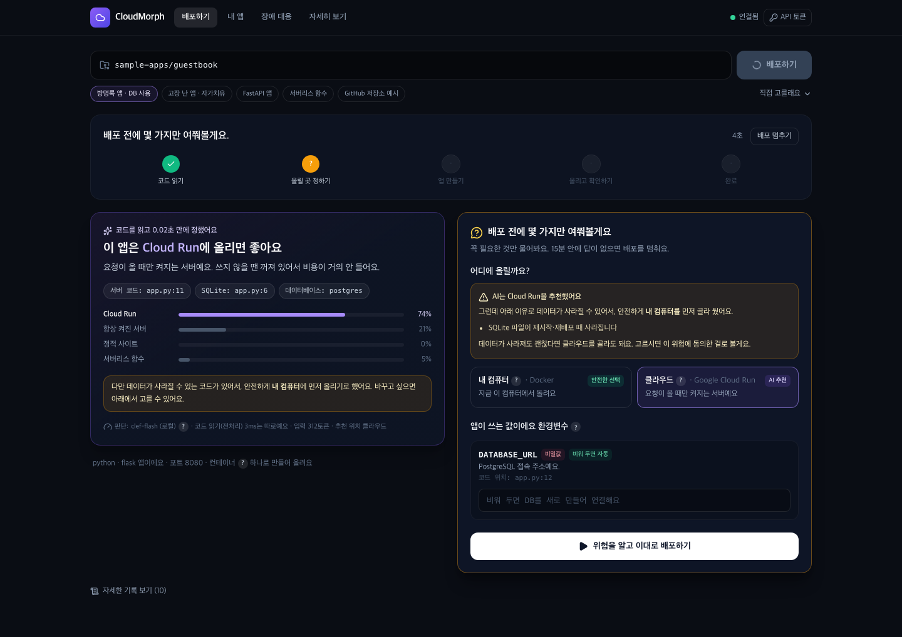
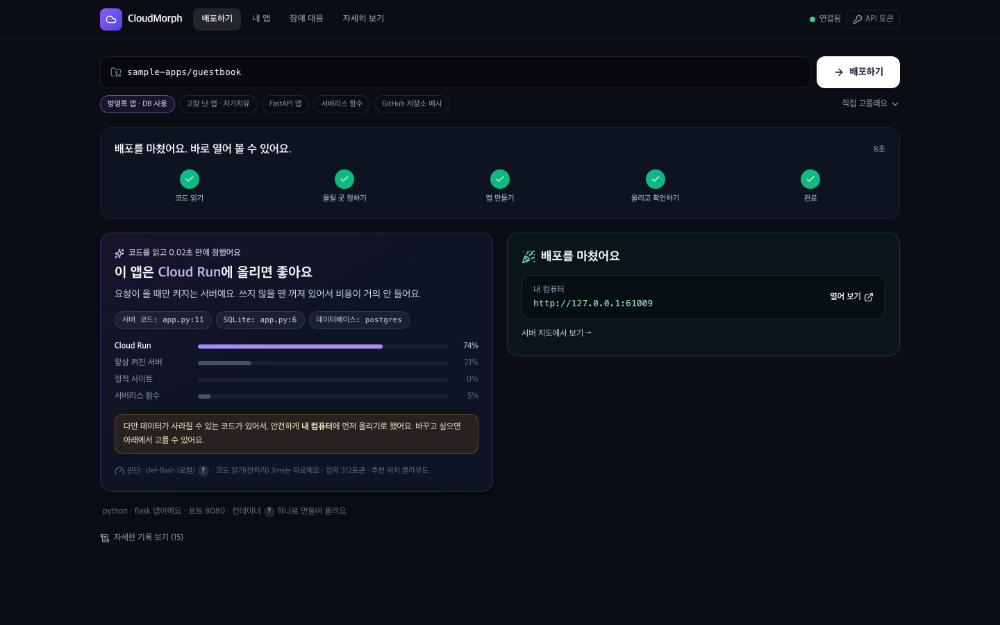
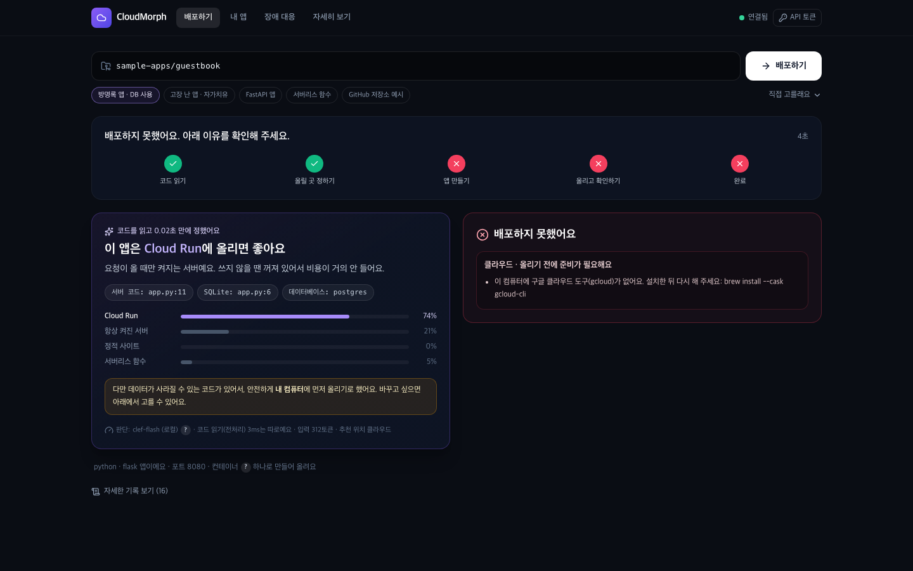
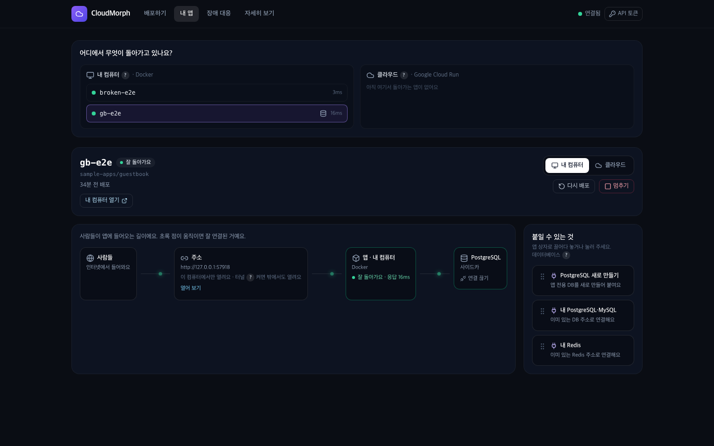
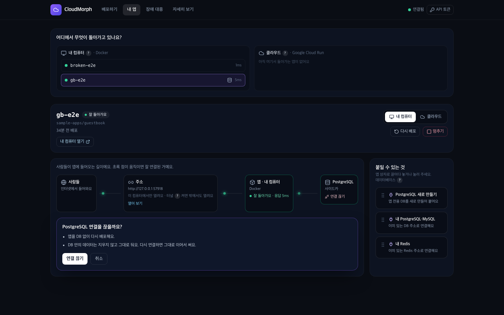
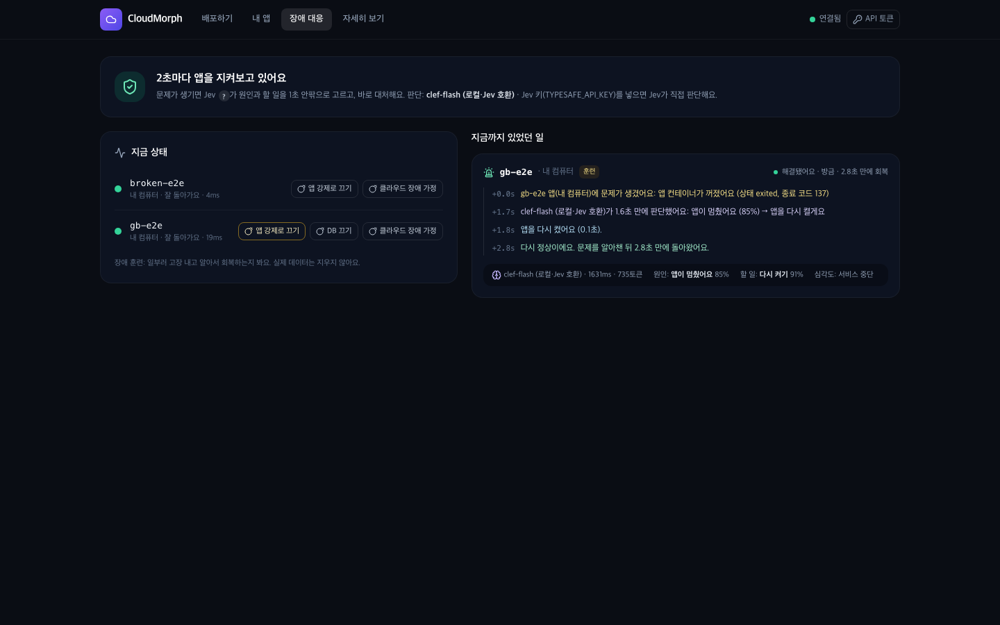
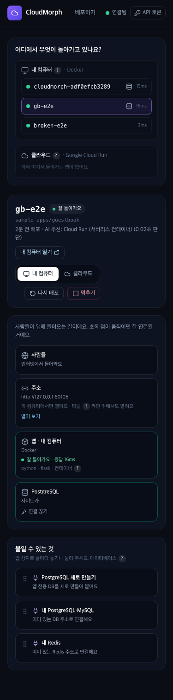

# 원터치 대시보드 (담당: 이요환)

Vercel처럼 주소 하나 넣고 한 번 누르면 배포되고, 배포한 앱을 지도로 보고, 장애가 나면 알아서 고치는 모습까지 보는 화면이다.
**첫 화면(`/`)이 원터치 배포**다. 팀의 3D 대시보드는 `#/3d`에서 그대로(전체 화면) 열리고, 두 화면은 서로 링크로 오간다
(원터치 → **3D 대시보드**, 3D 대시보드 헤더 → **원터치**). 라우팅은 `frontend/src/Root.jsx`, 화면은 `frontend/src/Shell.jsx`와 `frontend/src/onetouch/`.

| 탭 (`#/…`) | 하는 일 |
|---|---|
| 배포하기 (`deploy`) | 주소 입력 → **배포하기** 한 번. 1초 판단 카드 → (필요할 때만) 질문 카드 → 진행 5단계 → 결과 |
| 내 앱 (`apps`) | 어디서 무엇이 도는지 한눈에 보는 전체 지도, 앱 하나의 서버 지도(사람들 → 주소 → 앱 → DB), DB 끌어다 놓기, 내 컴퓨터 ↔ 클라우드 옮기기 |
| 장애 대응 (`incidents`) | 감시 상태, 앱별 건강, 장애 훈련 버튼, 사건 타임라인(알아챔 → Jev 판단 → 조치 → 회복) |

## 원터치 배포: 필요한 것만 묻는다

대시보드는 `POST /deploy`에 `targets: []`(CloudMorph가 고름)와 `ask_env: true`를 보낸다.

1. **1초 판단**: clef-flash가 고른 서비스(`log` `kind=decision`)가 분석이 끝나기 전에 온다. 근거 줄과 네 서비스의 확률을 보여 준다.
2. **질문은 필요할 때만**: 넣어야 할 값이 없고, 위험 때문에 추천이 바뀌지도 않았으면 묻지 않고 바로 배포한다.
   - 데이터 손실 위험(SQLite 등) 때문에 analyzer가 안전한 곳(내 컴퓨터)을 골랐으면, AI 추천(클라우드)과 이유를 같이 보여 주고 고르게 한다.
     위험한 쪽을 고르면 버튼이 **위험을 알고 이대로 배포하기**로 바뀐다. 그 선택이 동의다.
   - 코드를 고쳐야 할 때(healer)는 고치기 전에 묻고, 동의하면 그때 PR을 올린다 ([`interfaces.md`](interfaces.md)).
3. **실패는 고칠 방법으로**: 사전 점검 실패(예: `gcloud CLI not installed`)와 healer 요약을 "이 컴퓨터에 구글 클라우드 도구(gcloud)가 없어요.
   설치한 뒤 다시 해 주세요" 같은 문장으로 바꿔 보여 준다 (`onetouch/failure.js`). 원문은 **자세한 기록**에 남는다.

## 서버 지도와 DB 끌어다 놓기

- 지도: 사람들 → 주소 → 앱(떠 있는 곳마다 한 줄) → DB. 감시기의 건강 정보(`GET /incidents`의 `health`)로 색과 응답 시간을 칠하고,
  정상이면 선 위로 초록 점이 흐른다.
- 오른쪽 **붙일 수 있는 것**을 앱 상자로 끌어다 놓거나 누르면 확인창이 뜬다. 터치 기기와 키보드는 누르기로 똑같이 할 수 있다.
  - **PostgreSQL 새로 만들기**: 내 컴퓨터에서는 앱 옆에 DB 상자(사이드카), 클라우드에서는 Cloud SQL에 앱 전용 DB.
  - **내 PostgreSQL·MySQL / 내 Redis**: 갖고 있는 서버 주소로 연결. 주소는 화면·기록·`projects.json`에 남기지 않는다
    (메모리, 그리고 GCP가 있으면 Secret Manager).
  - **연결 끊기**: DB 없이 다시 배포한다. DB 안의 데이터는 지우지 않아서, 다시 붙이면 그대로 이어 쓴다.
  - 앱 코드가 그 DB 주소를 읽지 않으면 "연결해도 앱이 쓰지 않을 수 있어요"라고 먼저 알려 준다.
- API: `POST /projects/{name}/resources {kind: postgres|mysql|redis, mode: new|url|none, url?}` → 지금 떠 있는 곳에 다시 배포하고
  `deployment_id`를 돌려준다. 다시 배포할 때 `_apply_resources`가 deployer 옵션(`database`, `env`)으로 바꾼다.
- 실측(방명록 앱, 내 컴퓨터): 연결 끊기 → SQLite로 다시 뜸, PostgreSQL 새로 만들기 → 예전 글이 그대로 있는 사이드카에 다시 연결.

## 내 컴퓨터 ↔ 클라우드 옮기기

- 앱 머리글의 **내 컴퓨터 | 클라우드** 스위치. 확인창이 무엇이 바뀌는지(새 주소, 원래 자리는 내림, DB 데이터는 같이 안 옮겨짐)를 먼저 말한다.
- API: `POST /projects/{name}/move {to}` → 같은 이름·저장된 설정값으로 `to`에 보통 배포를 하고, 모든 새 자리가 뜬 뒤에만
  원래 자리를 `deployer.teardown`으로 내린다 (`_launch(retire=...)`). 새 자리가 실패하면 원래 자리는 그대로다.

## 말투 (토스 말투)

- 해요체, 한 문장에 한 가지. "배포를 마쳤어요. 바로 열어 볼 수 있어요."
- 쉬운 말 먼저, 피할 수 없는 용어는 **?** 버튼으로 한 줄 설명 (`onetouch/copy.js`의 `GLOSSARY`: 컨테이너, 사이드카, Cloud SQL, 터널,
  블루그린 배포, 자가치유, clef-flash, Jev, PR …).
- 버튼은 할 일로: 배포하기, 연결하기, 옮기기, 다시 켜기. 위험한 선택은 버튼 글자에 드러낸다 (위험을 알고 이대로 배포하기).
- 숫자는 구체적으로: "0.53초 만에 정했어요", "문제를 알아챈 뒤 2.8초 만에 돌아왔어요".
- 이름 뒤 조사는 받침에 맞춘다 (`josa('Cloud Run', '을', '를')` → "Cloud Run을", "DB를", "PostgreSQL을").

## 확인한 것

팀 프런트엔드 CI(vitest 182개 · oxlint · build · Playwright 49개)를 로컬에서 그대로 돌려 통과했다. 그중 `e2e/onetouch.pw.js` 4개가 이 화면을
본다: 첫 화면 한 번 누르기 → 1초 판단 → 위험한 선택만 묻기 → 완료, 서버 지도에 PostgreSQL을 실제로 끌어다 놓기, 장애 타임라인과 훈련, 3D 대시보드 왕복.
gstack 헤드리스 브라우저로 1440×900과 375×812에서 확인했다. 콘솔 오류 없음(Tailwind CDN 운영 경고만 있음), 휴대폰 너비에서 가로 넘침 없음.
원터치 배포(질문 → 안전한 선택 → 8~26초 완료), 클라우드 선택(동의 버튼 → gcloud 없음 안내), DB 끊기·다시 붙이기(데이터 유지),
장애 훈련(앱 강제 종료 → 2.8초 만에 회복)을 실제 백엔드·Docker로 돌려 봤다. Cloud Run으로 실제 옮기기는 이 Mac에 gcloud가 없어
단위 테스트(`test_move_takes_the_old_place_down_only_after_the_new_one_is_up`)로만 확인했다.
